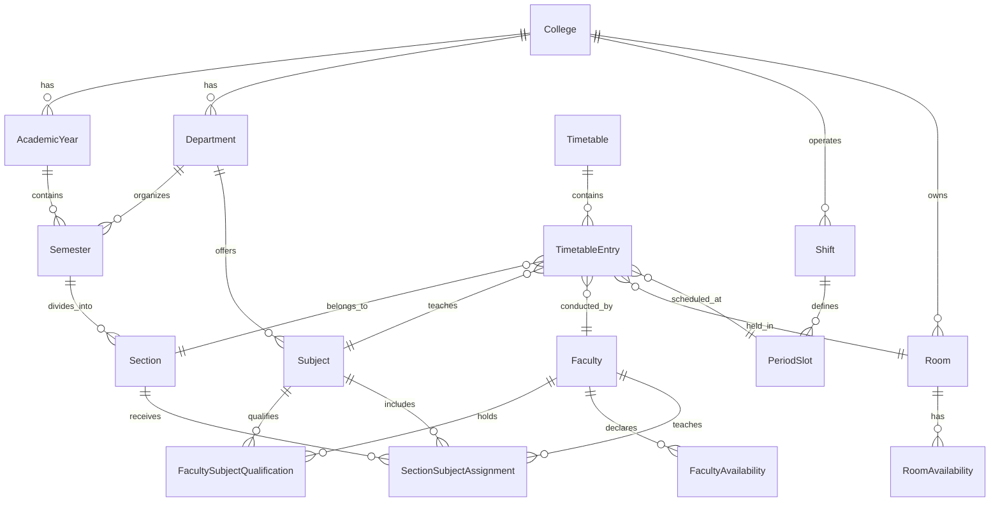

# CampusTime — Smart College Timetable Management System
## Master Architecture, Project Specification & Execution Plan

---

## 1. Executive Summary & Vision

**CampusTime** is an enterprise-grade, portfolio-quality, full-stack timetable generation and management system designed for collegiate institutions (e.g., colleges with multiple departments, shifts, sections, lab constraints, and faculty availability parameters).

The system replaces error-prone manual scheduling spreadsheets with a **Constraint Satisfaction Problem (CSP) scheduling engine**, coupled with an intuitive, responsive, high-performance web dashboard.

---

## 2. High-Level System Architecture

```mermaid
graph TB
    subgraph Client Layer [Frontend - React + TypeScript + Vite + Tailwind CSS]
        UI[UI Components / Lucide Icons]
        AdminApp[Admin Dashboard & Management]
        GenWizard[Timetable Generation Wizard]
        GridEditor[Interactive Timetable Grid & Editor]
        FacultyView[Faculty Schedule & Workload Portal]
        StudentView[Student Section Timetable View]
    end

    subgraph Gateway [API Layer - REST /api/v1/]
        AuthEndpoints[/api/v1/auth/*]
        AcademicEndpoints[/api/v1/academics/*]
        FacultyEndpoints[/api/v1/faculty/*]
        RoomEndpoints[/api/v1/rooms/*]
        TimetableEndpoints[/api/v1/timetables/*]
        AuditEndpoints[/api/v1/audit/*]
    end

    subgraph Backend Core [Django & Django REST Framework]
        AuthService[Role-Based Authentication & Permissions]
        AuditService[Audit Log & Version Tracker]
        ValidatorService[Independent Schedule Validator]
        PDFService[WeasyPrint / ReportLab PDF Generator]
    end

    subgraph Scheduling Engine [Standalone Python CSP Engine]
        PreflightCheck[Feasibility & Domain Check]
        CSPCore[Backtracking Solver with MRV + Degree Heuristics]
        ConstraintEnforcer[Hard & Soft Constraint Enforcer]
        Diagnostics[Conflict & Infeasibility Explainer]
    end

    subgraph Persistence [Database Layer]
        PostgreSQL[(PostgreSQL with Strict Relational Integrity)]
    end

    Client Layer -->|Axios / JWT / REST| Gateway
    Gateway --> Backend Core
    Backend Core --> Scheduling Engine
    Backend Core --> Persistence
    Scheduling Engine -.->|Reads Data & Validates| Persistence
```

---

## 3. Technology Stack & Tooling

| Component | Technology | Rationale |
|---|---|---|
| **Frontend Framework** | React 18 / 19, TypeScript, Vite | Fast HMR, strong type contracts matching backend models, minimal bundle overhead. |
| **Styling & Design System** | Tailwind CSS, Lucide React, Radix-inspired accessible primitives | Clean data-dense UI, WCAG AA compliance, dark/light theme ready, responsive tables/grids. |
| **Backend Framework** | Python 3.10+, Django 5.x, Django REST Framework | Mature ORM, transactional safety, declarative permissions, built-in migration system. |
| **Authentication** | SimpleJWT (JSON Web Tokens) with strict RBAC | Stateless access tokens with secure refresh; permissions enforced at model & viewset layers. |
| **Database** | PostgreSQL (with SQLite development fallback) | Robust relational constraints, atomic transactions, composite unique indexes, array/JSON support. |
| **PDF Generation** | ReportLab / WeasyPrint / HTML-to-PDF | Server-side pixel-perfect, printable schedule grids for departments, faculty, and sections. |
| **Testing** | Pytest-Django (Backend) + Vitest (Frontend) | Unit tests for constraint solver, API integration tests, and UI component tests. |

---

## 4. Database Schema & Data Models

The data layer is partitioned into focused Django applications:



### 4.1. Core Models Specification

#### `accounts` App
- **`User`**: Custom user extending `AbstractUser`.
  - Fields: `email` (unique), `role` (`ADMIN`, `FACULTY`, `STUDENT`), `phone_number`, `is_active`, `date_joined`.
- **`StudentProfile`**:
  - Fields: `user` (OneToOne), `enrollment_number`, `department` (FK), `section` (FK).

#### `academics` App
- **`College`**: Name, code, address, contact email.
- **`AcademicYear`**: Name (e.g. `2024-2025`), start date, end date, is_current (boolean).
- **`Shift`**: Name (`Shift I (Morning)`, `Shift II (Evening)`), start time, end time.
- **`PeriodSlot`**: Day of week (`MON`-`SAT`), shift (FK), period number (`1` to `N`), start time, end time, is_break (`False` for lecture, `True` for lunch/short break), break label.
  - *Unique Constraint*: `[shift, day_of_week, period_number]`.
- **`Department`**: Name (e.g. `Computer Science & Engineering`), code (`CSE`), college (FK).
- **`Semester`**: Academic year (FK), department (FK), semester number (1 to 8), shift (FK).
  - *Unique Constraint*: `[academic_year, department, semester_number, shift]`.
- **`Section`**: Name (`A`, `B`, `C`), semester (FK), student count.
  - *Unique Constraint*: `[semester, name]`.
- **`Subject`**: Department (FK), code (`CS501`), name (`Database Management Systems`), subject type (`THEORY`, `LAB`, `SEMINAR`), credits, weekly lecture periods required (e.g., 4), lab batch continuous periods (e.g., 2 or 3 for lab sessions).

#### `faculty` App
- **`Faculty`**: User (OneToOne), employee_id (unique), department (FK), designation (`PROFESSOR`, `ASSOCIATE_PROF`, `ASSISTANT_PROF`), max_weekly_periods (e.g. 18), max_daily_periods (e.g. 4).
- **`FacultySubjectQualification`**: Faculty (FK), Subject (FK), preference_level (1 to 5).
  - *Unique Constraint*: `[faculty, subject]`.
- **`FacultyAvailability`**: Faculty (FK), day_of_week, period_slot (FK), is_available (boolean).
  - *Unique Constraint*: `[faculty, period_slot]`.
- **`SectionSubjectAssignment`**: Section (FK), Subject (FK), Faculty (FK).
  - *Unique Constraint*: `[section, subject]` (one primary teacher assigned per section subject; can extend for lab co-teachers).

#### `rooms` App
- **`Room`**: Room number/name (`Lab 301`, `LH 102`), room type (`CLASSROOM`, `LAB`, `SEMINAR_HALL`), capacity, department (FK, nullable for shared rooms), building, floor.
- **`RoomAvailability`**: Room (FK), period_slot (FK), is_available (boolean).
  - *Unique Constraint*: `[room, period_slot]`.

#### `timetables` App
- **`Timetable`**: Academic year (FK), semester (FK, nullable if multi-semester), shift (FK), status (`DRAFT`, `REVIEW`, `PUBLISHED`, `ARCHIVED`), version (integer), created_by (FK User), published_at (datetime).
  - *Unique Constraint*: `[academic_year, semester, shift, version]`.
- **`TimetableEntry`**:
  - Timetable (FK)
  - Section (FK)
  - Subject (FK)
  - Faculty (FK)
  - Room (FK)
  - Day of week (`MON`..`SAT`)
  - PeriodSlot (FK)
  - is_locked (boolean - manual admin pin that generator must preserve)
  - *Strict Collision Checks & Unique Constraints*:
    - `[timetable, room, period_slot]` -> Room cannot be double-booked.
    - `[timetable, faculty, period_slot]` -> Faculty cannot be in two places at once.
    - `[timetable, section, period_slot]` -> Section cannot have two classes simultaneously.

#### `audit` App
- **`TimetableAuditLog`**: Timetable (FK), user (FK), action (`GENERATED`, `EDITED`, `PUBLISHED`, `REVERTED`), timestamp, diff_payload (JSON), notes.

---

## 5. Constraint Satisfaction Engine (Scheduling Engine)

The scheduling engine is implemented as a standalone, pure Python module within `apps/scheduling/`:

### 5.1. Variables & Domains
- **Variable**: Session Unit $U_{s, sub, k}$ representing the $k$-th weekly period requirement of Subject $sub$ for Section $s$.
- **Domain**: All combinations of $(\text{Day}, \text{PeriodSlot}, \text{Room})$ valid for Section $s$'s shift.

### 5.2. Hard Constraints (Zero Tolerance)
1. **No Section Collision**: A section can only have one active session per time slot.
2. **No Faculty Collision**: A faculty member cannot be scheduled to teach two sessions at the same time slot across any section or department.
3. **No Room Collision**: A room cannot host more than one session at the same time slot.
4. **Faculty Availability**: Faculty can only be scheduled in slots marked `is_available=True`.
5. **Room Availability & Type Match**: Theory sessions must be in `CLASSROOM` with `capacity >= section.student_count`; Lab sessions must be in `LAB` with `capacity >= section.student_count`.
6. **Consecutive Lab Blocks**: If a lab subject requires a 2-period or 3-period block, periods must be contiguous on the same day without an intervening break slot.
7. **Shift Compliance**: Sessions for a section must occur strictly within the period slots of that section's shift.
8. **Weekly Requirement Exactness**: The exact number of weekly lecture/lab periods assigned must equal the subject's target count.
9. **Break Preservation**: No lectures or labs can be scheduled during designated break slots.
10. **Pre-locked Slots**: Any slots manually locked by admin (`is_locked=True`) must remain fixed during regeneration.

### 5.3. Soft Constraints & Heuristics (Optimization)
1. **Workload Spread**: Distribute subject lectures evenly throughout the week (e.g. no 3 theory lectures of the same subject on the same day).
2. **Faculty Daily Maximum**: Keep daily periods for each faculty member $\le \text{max\_daily\_periods}$.
3. **Teacher Idle Gap Minimization**: Minimize fragmented empty "hole" periods between a teacher's classes.
4. **Room Proximity / Consistency**: Schedule a section in its home classroom whenever possible.

### 5.4. Algorithm Implementation
- **Technique**: Backtracking search with Forward Checking and Constraint Propagation (AC-3 concept).
- **Variable Ordering**: Most Constrained Variable (Minimum Remaining Values - MRV) and Most Constraining Variable (Degree Heuristic).
  - *Priority*: Consecutive lab blocks scheduled first (strictest constraints), followed by subjects with limited-availability faculty.
- **Value Ordering**: Least Constraining Value (LCV) to preserve maximum flexibility for remaining sessions.
- **Infeasibility Diagnostics**: If the solver terminates without finding a complete schedule within the timeout or backtrack limit:
  - It analyzes the conflict graph and identifies the bottleneck (e.g., "Faculty Dr. Sharma has 18 required periods but only 14 available slots", or "Room Lab 201 is overbooked by 6 hours on Wednesday").
  - Clear, actionable error reports returned to admin.
- **Independent Verifier**: A separate verification module checks every generated or manually modified schedule against all 10 hard constraints before any draft can be saved or published.

---

## 6. REST API Design (`/api/v1/`)

| Method | Endpoint | Description | Roles |
|---|---|---|---|
| `POST` | `/api/v1/auth/login/` | Obtain JWT access + refresh tokens | Public |
| `POST` | `/api/v1/auth/refresh/` | Refresh expired access token | Public |
| `GET` | `/api/v1/auth/me/` | Current user profile, role, and permissions | Authenticated |
| `GET/POST` | `/api/v1/academics/colleges/` | College settings | Admin |
| `GET/POST` | `/api/v1/academics/academic-years/` | Academic years setup | Admin |
| `GET/POST` | `/api/v1/academics/shifts/` | Shift I / Shift II timings | Admin |
| `GET/POST` | `/api/v1/academics/period-slots/` | Periods and break slots | Admin |
| `GET/POST` | `/api/v1/academics/departments/` | Departments CRUD | Admin |
| `GET/POST` | `/api/v1/academics/semesters/` | Semesters CRUD | Admin |
| `GET/POST` | `/api/v1/academics/sections/` | Sections CRUD | Admin |
| `GET/POST` | `/api/v1/academics/subjects/` | Subjects (theory/lab, weekly credits) | Admin |
| `GET/POST` | `/api/v1/faculty/profiles/` | Faculty profile management | Admin |
| `GET/POST` | `/api/v1/faculty/qualifications/` | Faculty-subject qualification mapping | Admin |
| `GET/PUT` | `/api/v1/faculty/availability/` | Weekly availability grid per faculty | Admin, Faculty (own) |
| `GET/POST` | `/api/v1/faculty/assignments/` | Section-subject-faculty allocations | Admin |
| `GET/POST` | `/api/v1/rooms/` | Rooms & labs, capacity, type | Admin |
| `GET/PUT` | `/api/v1/rooms/availability/` | Room availability overrides | Admin |
| `GET/POST` | `/api/v1/timetables/` | Timetables list, metadata, versions | Admin, Faculty, Student |
| `POST` | `/api/v1/timetables/generate/` | Trigger scheduling engine (background/sync) | Admin |
| `GET` | `/api/v1/timetables/{id}/grid/` | Fetch grid view filtered by section/faculty/room | Authenticated |
| `POST` | `/api/v1/timetables/{id}/validate/` | Run independent verification engine | Admin |
| `PATCH` | `/api/v1/timetables/{id}/entries/{entryId}/` | Update single slot (drag/drop or edit) | Admin |
| `POST` | `/api/v1/timetables/{id}/publish/` | Transition status to PUBLISHED | Admin |
| `GET` | `/api/v1/timetables/{id}/export-pdf/` | Generate printable PDF schedule | Authenticated |
| `GET` | `/api/v1/timetables/{id}/conflicts/` | Fetch live conflict and workload diagnostic report | Admin |
| `GET` | `/api/v1/audit/logs/` | View change history and audit trail | Admin |

---

## 7. Frontend UI/UX Design System

Following **UI/UX Pro Max** guidelines for an academic scheduling command center:

- **Theme & Palette**:
  - Background: Crisp Slate (`#0B0F19` dark / `#F8FAFC` light)
  - Card & Surfaces: `#111827` / `#FFFFFF` with refined subtle border borders (`#E2E8F0` / `#1E293B`)
  - Primary / Brand: Indigo / Deep Blue (`#4F46E5` / `#3B82F6`)
  - Accent / Positive: Emerald (`#10B981`) for conflict-free / published states
  - Warning / Conflict: Amber (`#F59E0B`) / Crimson (`#EF4444`) for hard collision alerts
- **Typography**: `Inter` / `Plus Jakarta Sans` for UI labels; `JetBrains Mono` for time stamps, room numbers, and subject codes.
- **Component Primitives**:
  - Responsive App Shell: Collapsible sidebar, breadcrumb header, user profile badge, active shift pill.
  - Interactive Timetable Grid: Time-axis columns × Day-axis rows (or Days × Periods) with color-coded subject chips, instructor avatars, room tags, and lock icons.
  - Drag-and-Drop / Slot Editor Modal: Instant client-side conflict preview before committing to backend.
  - Generation Wizard: Step-by-step preflight checklist (Requirements vs Capacity vs Availability) with live generation progress and conflict summary.

---

## 8. Phased Development Roadmap & Milestones

### Phase 1: Environment Inspection, Architecture & Directory Skeleton (Current)
- [x] Inspect local tools: Python 3.10.4, Node v24.19.0, npm 11.17.0, Git 2.44.0.
- [x] Identify prerequisites: PostgreSQL server configuration (with automatic SQLite fallback for zero-setup local dev).
- [x] Initialize Git repository with `main` branch.
- [x] Create `.gitignore` and `.env.example`.
- [x] Author comprehensive `PROJECT_PLAN.md`.
- [x] Author `README.md`.
- [x] Establish backend and frontend workspace directory structure.

### Phase 2: Backend Foundations, Models & Migrations
- Setup Django project (`campustime`) and apps: `accounts`, `academics`, `faculty`, `rooms`, `timetables`, `scheduling`, `audit`.
- Configure `settings.py` with PostgreSQL support (`DATABASE_URL`), fallback to SQLite, DRF, CORS, SimpleJWT.
- Define relational models with strict constraints and composite indexes.
- Generate and apply initial database migrations.
- Create initial database seeder / management command (`python manage.py seed_academic_data`) with realistic sample university data.

### Phase 3: Authentication & Academic Management APIs
- Implement User & Profile serializers, JWT token views, role permissions.
- Implement CRUD ViewSets for Colleges, Academic Years, Shifts, Period Slots, Departments, Semesters, Sections, and Subjects.
- Unit and integration tests for academic endpoints.

### Phase 4: Frontend Scaffolding, Design System & Core Dashboard
- Initialize Vite React TypeScript frontend with Tailwind CSS and Lucide icons.
- Setup API client, Auth Context, JWT storage, and Role-Based Route Guards.
- Build modern responsive layout (Sidebar, Navbar, Notification drawer).
- Build Admin Dashboard overview with academic metrics and quick actions.

### Phase 5: Faculty Availability & Subject Allocation Modules (Completed)
- [x] Complete authenticated REST APIs under `/api/v1/faculty/` (`profiles`, `qualifications`, `availability`, `batch-update`, `assignments`) and `/api/v1/rooms/` (`rooms`, `availability`).
- [x] Enforce institutional constraints: subject qualifications, cross-college isolation, break period availability blocking, and teacher max weekly periods capacity.
- [x] Weekly Faculty Availability Matrix in React with Days × Periods grid, preferred slot differentiation, break period protection, bulk actions (day, period, all), and atomic batch updates.
- [x] Subject–Teacher–Section Allocation interface with cascading selection, qualified instructor filtering, live capacity forecasting, room feasibility validation, and missing allocation warnings.
- [x] Faculty Workload Overview & Directory with utilization tracking and assignment breakdowns.
- [x] Rooms & Laboratories management with capacity filtering and department affinity tagging.
- [x] 13 new backend pytest tests (55 passing total) and 8 new frontend vitest tests (17 passing total).

### Phase 6: Automatic Timetable Generator Engine (Completed)
- [x] Implemented standalone Python scheduling engine inside `backend/apps/scheduling/services/` with strict separation of concerns:
  - `requirement_loader.py`: In-memory `SchedulingContext` extraction resolving sections, slots, rooms, faculty availability, workload limits, curriculum requirements, and locked bookings.
  - `session_expander.py`: Deconstructs weekly curriculum teaching requirements into atomic `SchedulableSession` units with linked UUIDs for multi-period blocks.
  - `placement_generator.py`: Candidate domain pre-filtering adhering to shift timings, contiguous non-break slots, room type and capacity, faculty availability, and soft scoring.
  - `solver.py`: Constraint-based CSP solver with Most Constrained Variable (MRV) ordering, Degree heuristic tie-breaker, forward checking with domain wipeout detection, and configurable search limits.
  - `validator.py`: Independent schedule validation engine (`validate_schedule` and `validate_timetable_instance`) checking all 12 hard constraints with structured diagnostic codes.
  - `diagnostics.py`: Conflict diagnostics service analyzing operational bottlenecks (room capacity, room type, faculty availability saturation, shift slot saturation).
  - `persistence.py`: Atomic database persistence service preserving locked entries, preventing overwriting of published schedules, and logging to `TimetableAuditLog`.
  - `engine.py`: High-level orchestrator facade unifying the end-to-end generation lifecycle.
- [x] Authenticated REST API endpoints under `/api/v1/timetables/`:
  - `POST /api/v1/timetables/generate/`: Scope-defined timetable generation (Admin only).
  - `GET /api/v1/timetables/{id}/conflicts/`: Diagnostic validation conflict inspection.
  - `POST /api/v1/timetables/{id}/validate/`: Draft re-validation.
  - `GET /api/v1/timetables/{id}/entries/`: Filterable scheduled session retrieval.
  - `POST /api/v1/timetables/{id}/publish/`: Validation-gated timetable publication.
  - `GET /api/v1/timetables/generation-jobs/{id}/`: Job status retrieval.
  - `POST /api/v1/timetables/entry-records/{id}/lock/` and `unlock/`: Granular slot locking.
- [x] Frontend React Integration:
  - Timetable Generation Wizard with Academic Scope selection (AY, Shift, Dept, Semester, Section).
  - Engine Optimization controls (Max Backtracks, Timeout seconds, Title, Notes).
  - Real-time generation progress, status banners, and search metric cards (Sessions, Backtracks, Duration, Nodes).
  - Conflict Diagnostics Panel with bottleneck categories, affected entities, and recommended actions.
  - Weekly Timetable Grid Preview with period/day layout, section filter, lab badges, and slot lock/unlock toggles.
  - Institutional Timetable List Page (`/timetables`) with status filtering.
- [x] Full Test Verification:
  - 10 new backend tests (65 total passing) covering solver correctness, collision prevention, multi-section shared faculty/rooms, consecutive lab contiguity, room capacity/type, workload limits, locked entry preservation, independent validator corruption detection, search limit handling, publication gate, and role authorization.
  - 3 new frontend tests (20 total passing) verifying wizard rendering, generation mutation, diagnostics display, and validation actions.
  - Zero TypeScript errors (`tsc && vite build` passing).

### Phase 7: Timetable Editing, Publishing, PDF Export & End-to-End Verification (Completed)
- [x] Timetable Slot Editor:
  - Interactive manual class movement and reassignment (`POST /api/v1/timetables/entry-records/{id}/move/`).
  - Strict server-side collision validation (Section, Faculty, Room, Break, Shift, Room capacity & type).
  - Multi-period lab block contiguity protection against fragmentation.
  - Locked-entry preservation and published schedule immutability.
  - Atomic database transactions with rollback on validation failure and audit logging (`MANUAL_OVERRIDE`).
- [x] Publication & Version Forking:
  - Validation-gated publication (`POST /api/v1/timetables/{id}/publish/`).
  - Immutable published schedules: forking revisions via `POST /api/v1/timetables/{id}/create-revision/` creates incremental draft versions.
  - Append-only audit history tracking all manual edits, locks, validations, and publication events.
- [x] Publication-Quality Landscape PDF Export:
  - Built with ReportLab 5.0 (`TimetablePDFGenerator` in `backend/apps/timetables/services/pdf_generator.py`).
  - Section-wise, Faculty-wise, and Room-wise printable PDF schedules (`GET /api/v1/timetables/{id}/export-pdf/`).
  - Formatted institutional headers, period timings, day rows, recess highlights, and curriculum subject legend.
- [x] Student and Faculty Scoped Views:
  - Endpoint `GET /api/v1/timetables/my-schedule/` with role scoping (Students see their section, Faculty see their assigned classes).
  - Draft schedules concealed from students and unauthorized users.
  - Frontend `MySchedulePage` (`/my-schedule`) with one-click official PDF download.
- [x] Reporting & Operational Analytics:
  - Faculty workload distribution report (`/reports/workload/`).
  - Room utilization report (`/reports/room-utilization/`).
  - Comprehensive schedule summary report (`/reports/summary/`).
- [x] Full Automated Verification:
  - 6 new end-to-end backend tests in `test_timetable_e2e_workflow.py` (71 total backend tests passing).
  - 3 new frontend tests in `MySchedulePage.test.tsx` (23 total frontend tests passing).
  - Production build passing with 0 TypeScript errors.

### Phase 9: End-to-End Verification & Production Readiness
- Run end-to-end tests across all user roles (Admin, Faculty, Student).
- Build production bundles (Django static collection, Vite production build).
- Final documentation and deployment instructions.

---

## 9. Acceptance Criteria

1. **Academic Configuration**: An admin can cleanly configure shifts, periods, departments, semesters, sections, subjects, faculty availability, and rooms.
2. **Strict Scheduling Correctness**:
   - Zero faculty collisions across the institution.
   - Zero room collisions across all sections.
   - Zero section collisions within any period.
   - All lab sessions placed in contiguous slots in designated lab rooms.
   - Shift I and Shift II never cross boundaries.
3. **Infeasibility Transparency**: If an impossible constraint is given (e.g. 30 periods required but only 20 slots exist), generator returns descriptive diagnostics instead of crashing.
4. **Editable & Validated**: Admins can edit draft schedules, and any invalid manual edit is rejected by server-side re-validation.
5. **Role Separation**: Faculty only see their assignments and student sections only see published timetables.
